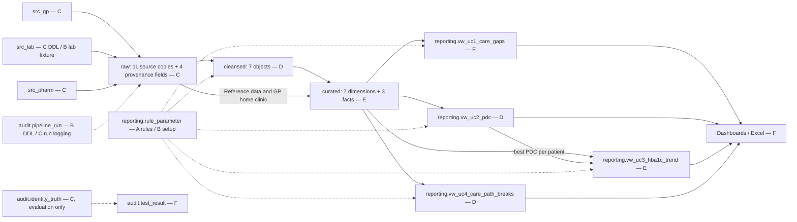
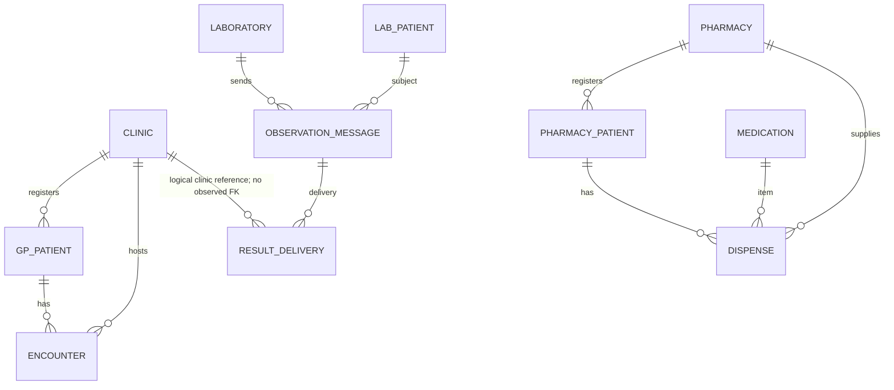
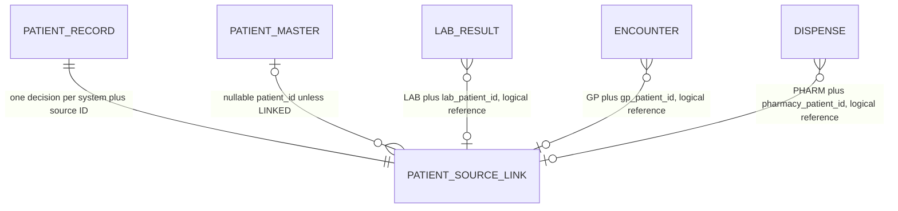
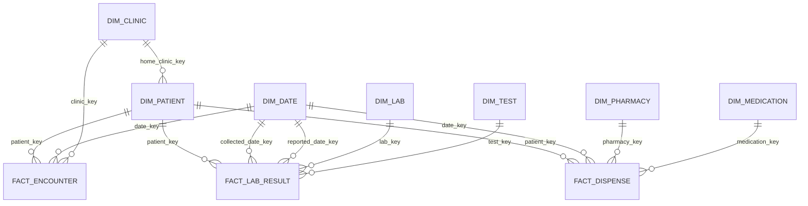

# Package B — logical model v1

Updated 2026-10-07; owner review pending. Companion: data_dictionary_v1.md (47 objects / 338 columns). **This is documentation, not DDL.** D/E/C/F own their implementations; proposed columns and unenforced logical references require their approval. Every field/type/nullability and observed constraint is listed in the dictionary.

## Layer lineage

## Source relationships

These show intended business references. Actual FK columns in source tables can be nullable: consult the observed dictionary rather than interpreting a drawn relationship as a NOT NULL constraint. A message may have no delivery; a message ID is not an Observation ID. RAW has all eleven mapped payload tables but no copied source constraints.

## Identity and quality relationships

The target is 48 source records and decisions, 17 canonical masters, 46 LINKED / 1 REVIEW / 1 UNMATCHED. DQ issues reference table plus record identifiers; an exact enforced FK across several target tables is not implied. Identity truth is separate from operational matching. Unresolved rows remain inspectable and do not enter patient-linked facts.

## Conformed dimensional model

Field/type proposals for the patient dimension and facts are taken from E-owned star_schema_v1.drawio; exact constraints await final E SQL. Observed dimensions are documented as observed. Each fact is one event; never join all facts at patient level before aggregation. Home clinic follows v3 D8: the clinic belonging to the lowest gp_patient_id among that master's GP records.

## Reporting dependencies

UC3 reads UC2 for patient-level PDC. UC4 uses `curated.fact_lab_result.result_returned_flag` for delivery status; it does not query RAW delivery evidence directly. Views have no primary keys.

CLEANSED encounter and dispense retain source identifiers for traceability, but have no foreign keys to `src_*`. Data-flow arrows do not imply an enforced constraint.

## Full object inventory

### audit.pipeline_run

One explicitly logged pipeline execution. Observed 2026-10-06.

`run_id: bigint [PRIMARY KEY (run_id)]; nullable No`  
`pipeline_name: text; nullable No`  
`started_at: timestamp with time zone; nullable No`  
`finished_at: timestamp with time zone; nullable Yes`  
`rows_read: bigint; nullable No`  
`rows_loaded: bigint; nullable No`  
`rows_rejected: bigint; nullable No`  
`status: text; nullable No`  
`error_message: text; nullable Yes`

### cleansed.patient_record

One standardised source patient record; source system and source ID distinguish identities. Observed 2026-10-06.

`source_system: text [PRIMARY KEY (source_system, source_patient_id)]; nullable No`  
`source_patient_id: text [PRIMARY KEY (source_system, source_patient_id)]; nullable No`  
`given_name: text; nullable Yes`  
`family_name: text; nullable Yes`  
`dob: date; nullable Yes`  
`sex: character(1); nullable Yes`  
`medicare10: text; nullable Yes`  
`postcode: text; nullable Yes`

### curated.dim_clinic

One clinic dimension member. Observed 2026-10-06.

`clinic_key: integer [PRIMARY KEY (clinic_key)]; nullable No`  
`clinic_id: integer [UNIQUE (clinic_id)]; nullable No`  
`clinic_name: text; nullable Yes`  
`suburb: text; nullable Yes`  
`postcode: text; nullable Yes`

### curated.dim_date

One date dimension member. Observed 2026-10-06.

`date_key: integer [PRIMARY KEY (date_key)]; nullable No`  
`full_date: date [UNIQUE (full_date)]; nullable No`  
`day: integer; nullable No`  
`month: integer; nullable No`  
`month_name: text; nullable No`  
`quarter: integer; nullable No`  
`year: integer; nullable No`

### curated.dim_lab

One lab dimension member. Observed 2026-10-06.

`lab_key: integer [PRIMARY KEY (lab_key)]; nullable No`  
`lab_id: integer [UNIQUE (lab_id)]; nullable No`  
`lab_name: text; nullable Yes`  
`reporting_unit: text; nullable Yes`

### curated.dim_medication

One medication dimension member. Observed 2026-10-06.

`medication_key: integer [PRIMARY KEY (medication_key)]; nullable No`  
`pbs_item_code: text [UNIQUE (pbs_item_code)]; nullable No`  
`drug_name: text; nullable Yes`  
`strength: text; nullable Yes`  
`pack_size: integer; nullable Yes`  
`typical_daily_dose: numeric; nullable Yes`  
`drug_class: text; nullable Yes`

### curated.dim_pharmacy

One pharmacy dimension member. Observed 2026-10-06.

`pharmacy_key: integer [PRIMARY KEY (pharmacy_key)]; nullable No`  
`pharmacy_id: integer [UNIQUE (pharmacy_id)]; nullable No`  
`pharmacy_name: text; nullable Yes`  
`suburb: text; nullable Yes`

### curated.dim_test

One test dimension member. Observed 2026-10-06.

`test_key: integer [PRIMARY KEY (test_key)]; nullable No`  
`loinc_code: text [UNIQUE (loinc_code)]; nullable No`  
`test_name: text; nullable No`  
`reported_unit: text; nullable No`

### reporting.rule_parameter

One named business-rule parameter. Observed 2026-10-06.

`param_name: text [PRIMARY KEY (param_name)]; nullable No`  
`param_value: text; nullable No`  
`description: text; nullable No`

### src_gp.clinic

One GP clinic. Observed 2026-10-06.

`clinic_id: integer [PRIMARY KEY (clinic_id)]; nullable No`  
`clinic_name: text; nullable Yes`  
`suburb: text; nullable Yes`  
`postcode: text; nullable Yes`

### src_gp.encounter

One GP encounter. Observed 2026-10-06.

`encounter_id: text [PRIMARY KEY (encounter_id)]; nullable No`  
`gp_patient_id: text [FOREIGN KEY (gp_patient_id) REFERENCES src_gp.gp_patient(gp_patient_id)]; nullable Yes`  
`clinic_id: integer [FOREIGN KEY (clinic_id) REFERENCES src_gp.clinic(clinic_id)]; nullable Yes`  
`encounter_date: date; nullable Yes`  
`encounter_type: text; nullable Yes`  
`diagnosis_code: text; nullable Yes`  
`medication_review_flag: boolean; nullable Yes`  
`care_plan_flag: boolean; nullable Yes`

### src_gp.gp_patient

One GP registration, not necessarily one real person. Observed 2026-10-06.

`gp_patient_id: text [PRIMARY KEY (gp_patient_id)]; nullable No`  
`first_name: text; nullable Yes`  
`last_name: text; nullable Yes`  
`dob: date; nullable Yes`  
`sex: character(1); nullable Yes`  
`postcode: text; nullable Yes`  
`medicare_number: text; nullable Yes`  
`clinic_id: integer [FOREIGN KEY (clinic_id) REFERENCES src_gp.clinic(clinic_id)]; nullable Yes`  
`enrolment_date: date; nullable Yes`

### src_lab.lab_patient

One laboratory patient record. Observed 2026-10-06.

`lab_patient_id: text [PRIMARY KEY (lab_patient_id)]; nullable No`  
`patient_name: text; nullable Yes`  
`dob: text; nullable Yes`  
`sex: character(1); nullable Yes`  
`medicare_number: text; nullable Yes`

### src_lab.laboratory

One laboratory. Observed 2026-10-06.

`lab_id: integer [PRIMARY KEY (lab_id)]; nullable No`  
`lab_name: text; nullable Yes`  
`reporting_unit: text; nullable Yes`

### src_lab.observation_message

One received FHIR Observation message; duplicate clinical events remain separate messages. Observed 2026-10-06.

`message_id: text [PRIMARY KEY (message_id)]; nullable No`  
`lab_id: integer [FOREIGN KEY (lab_id) REFERENCES src_lab.laboratory(lab_id)]; nullable Yes`  
`lab_patient_id: text [FOREIGN KEY (lab_patient_id) REFERENCES src_lab.lab_patient(lab_patient_id)]; nullable Yes`  
`received_at: timestamp with time zone; nullable Yes`  
`fhir_json: jsonb; nullable Yes`

### src_lab.result_delivery

One recorded delivery of a message to a clinic. Observed 2026-10-06.

`delivery_id: text [PRIMARY KEY (delivery_id)]; nullable No`  
`message_id: text [FOREIGN KEY (message_id) REFERENCES src_lab.observation_message(message_id)]; nullable Yes`  
`clinic_id: integer; nullable Yes`  
`delivered_at: timestamp with time zone; nullable Yes`

### src_pharm.dispense

One dispensing event. Observed 2026-10-06.

`dispense_id: text [PRIMARY KEY (dispense_id)]; nullable No`  
`pharmacy_patient_id: text [FOREIGN KEY (pharmacy_patient_id) REFERENCES src_pharm.pharmacy_patient(pharmacy_patient_id)]; nullable Yes`  
`pharmacy_id: integer [FOREIGN KEY (pharmacy_id) REFERENCES src_pharm.pharmacy(pharmacy_id)]; nullable Yes`  
`pbs_item_code: text [FOREIGN KEY (pbs_item_code) REFERENCES src_pharm.medication(pbs_item_code)]; nullable Yes`  
`dispensed_date: date; nullable Yes`  
`quantity: integer; nullable Yes`  
`days_supply: integer; nullable Yes`

### src_pharm.medication

One PBS medication item. Observed 2026-10-06.

`pbs_item_code: text [PRIMARY KEY (pbs_item_code)]; nullable No`  
`drug_name: text; nullable Yes`  
`strength: text; nullable Yes`  
`pack_size: integer; nullable Yes`  
`typical_daily_dose: numeric; nullable Yes`  
`drug_class: text; nullable Yes`

### src_pharm.pharmacy

One pharmacy. Observed 2026-10-06.

`pharmacy_id: integer [PRIMARY KEY (pharmacy_id)]; nullable No`  
`pharmacy_name: text; nullable Yes`  
`suburb: text; nullable Yes`

### src_pharm.pharmacy_patient

One pharmacy patient registration. Observed 2026-10-06.

`pharmacy_patient_id: text [PRIMARY KEY (pharmacy_patient_id)]; nullable No`  
`given_name: text; nullable Yes`  
`surname: text; nullable Yes`  
`date_of_birth: text; nullable Yes`  
`medicare_number: text; nullable Yes`  
`pharmacy_id: integer [FOREIGN KEY (pharmacy_id) REFERENCES src_pharm.pharmacy(pharmacy_id)]; nullable Yes`

### raw.gp_clinic

One unchanged source row from src_gp.clinic. Contract draft; not observed.

`clinic_id: integer [No RAW constraint]; nullable TBD`  
`clinic_name: text [No RAW constraint]; nullable TBD`  
`suburb: text [No RAW constraint]; nullable TBD`  
`postcode: text [No RAW constraint]; nullable TBD`  
`_source_system: text; nullable TBD`  
`_source_table: text; nullable TBD`  
`_pipeline_run_id: bigint [Logical reference audit.pipeline_run.run_id (not enforced)]; nullable TBD`  
`_loaded_at: timestamptz; nullable TBD`

### raw.gp_patient

One unchanged source row from src_gp.gp_patient. Contract draft; not observed.

`gp_patient_id: text [No RAW constraint]; nullable TBD`  
`first_name: text [No RAW constraint]; nullable TBD`  
`last_name: text [No RAW constraint]; nullable TBD`  
`dob: date [No RAW constraint]; nullable TBD`  
`sex: character(1) [No RAW constraint]; nullable TBD`  
`postcode: text [No RAW constraint]; nullable TBD`  
`medicare_number: text [No RAW constraint]; nullable TBD`  
`clinic_id: integer [No RAW constraint]; nullable TBD`  
`enrolment_date: date [No RAW constraint]; nullable TBD`  
`_source_system: text; nullable TBD`  
`_source_table: text; nullable TBD`  
`_pipeline_run_id: bigint [Logical reference audit.pipeline_run.run_id (not enforced)]; nullable TBD`  
`_loaded_at: timestamptz; nullable TBD`

### raw.gp_encounter

One unchanged source row from src_gp.encounter. Contract draft; not observed.

`encounter_id: text [No RAW constraint]; nullable TBD`  
`gp_patient_id: text [No RAW constraint]; nullable TBD`  
`clinic_id: integer [No RAW constraint]; nullable TBD`  
`encounter_date: date [No RAW constraint]; nullable TBD`  
`encounter_type: text [No RAW constraint]; nullable TBD`  
`diagnosis_code: text [No RAW constraint]; nullable TBD`  
`medication_review_flag: boolean [No RAW constraint]; nullable TBD`  
`care_plan_flag: boolean [No RAW constraint]; nullable TBD`  
`_source_system: text; nullable TBD`  
`_source_table: text; nullable TBD`  
`_pipeline_run_id: bigint [Logical reference audit.pipeline_run.run_id (not enforced)]; nullable TBD`  
`_loaded_at: timestamptz; nullable TBD`

### raw.lab_laboratory

One unchanged source row from src_lab.laboratory. Contract draft; not observed.

`lab_id: integer [No RAW constraint]; nullable TBD`  
`lab_name: text [No RAW constraint]; nullable TBD`  
`reporting_unit: text [No RAW constraint]; nullable TBD`  
`_source_system: text; nullable TBD`  
`_source_table: text; nullable TBD`  
`_pipeline_run_id: bigint [Logical reference audit.pipeline_run.run_id (not enforced)]; nullable TBD`  
`_loaded_at: timestamptz; nullable TBD`

### raw.lab_patient

One unchanged source row from src_lab.lab_patient. Contract draft; not observed.

`lab_patient_id: text [No RAW constraint]; nullable TBD`  
`patient_name: text [No RAW constraint]; nullable TBD`  
`dob: text [No RAW constraint]; nullable TBD`  
`sex: character(1) [No RAW constraint]; nullable TBD`  
`medicare_number: text [No RAW constraint]; nullable TBD`  
`_source_system: text; nullable TBD`  
`_source_table: text; nullable TBD`  
`_pipeline_run_id: bigint [Logical reference audit.pipeline_run.run_id (not enforced)]; nullable TBD`  
`_loaded_at: timestamptz; nullable TBD`

### raw.lab_observation

One unchanged source row from src_lab.observation_message. Contract draft; not observed.

`message_id: text [No RAW constraint]; nullable TBD`  
`lab_id: integer [No RAW constraint]; nullable TBD`  
`lab_patient_id: text [No RAW constraint]; nullable TBD`  
`received_at: timestamp with time zone [No RAW constraint]; nullable TBD`  
`fhir_json: jsonb [No RAW constraint]; nullable TBD`  
`_source_system: text; nullable TBD`  
`_source_table: text; nullable TBD`  
`_pipeline_run_id: bigint [Logical reference audit.pipeline_run.run_id (not enforced)]; nullable TBD`  
`_loaded_at: timestamptz; nullable TBD`

### raw.lab_delivery

One unchanged source row from src_lab.result_delivery. Contract draft; not observed.

`delivery_id: text [No RAW constraint]; nullable TBD`  
`message_id: text [No RAW constraint]; nullable TBD`  
`clinic_id: integer [No RAW constraint]; nullable TBD`  
`delivered_at: timestamp with time zone [No RAW constraint]; nullable TBD`  
`_source_system: text; nullable TBD`  
`_source_table: text; nullable TBD`  
`_pipeline_run_id: bigint [Logical reference audit.pipeline_run.run_id (not enforced)]; nullable TBD`  
`_loaded_at: timestamptz; nullable TBD`

### raw.pharm_pharmacy

One unchanged source row from src_pharm.pharmacy. Contract draft; not observed.

`pharmacy_id: integer [No RAW constraint]; nullable TBD`  
`pharmacy_name: text [No RAW constraint]; nullable TBD`  
`suburb: text [No RAW constraint]; nullable TBD`  
`_source_system: text; nullable TBD`  
`_source_table: text; nullable TBD`  
`_pipeline_run_id: bigint [Logical reference audit.pipeline_run.run_id (not enforced)]; nullable TBD`  
`_loaded_at: timestamptz; nullable TBD`

### raw.pharm_medication

One unchanged source row from src_pharm.medication. Contract draft; not observed.

`pbs_item_code: text [No RAW constraint]; nullable TBD`  
`drug_name: text [No RAW constraint]; nullable TBD`  
`strength: text [No RAW constraint]; nullable TBD`  
`pack_size: integer [No RAW constraint]; nullable TBD`  
`typical_daily_dose: numeric [No RAW constraint]; nullable TBD`  
`drug_class: text [No RAW constraint]; nullable TBD`  
`_source_system: text; nullable TBD`  
`_source_table: text; nullable TBD`  
`_pipeline_run_id: bigint [Logical reference audit.pipeline_run.run_id (not enforced)]; nullable TBD`  
`_loaded_at: timestamptz; nullable TBD`

### raw.pharm_patient

One unchanged source row from src_pharm.pharmacy_patient. Contract draft; not observed.

`pharmacy_patient_id: text [No RAW constraint]; nullable TBD`  
`given_name: text [No RAW constraint]; nullable TBD`  
`surname: text [No RAW constraint]; nullable TBD`  
`date_of_birth: text [No RAW constraint]; nullable TBD`  
`medicare_number: text [No RAW constraint]; nullable TBD`  
`pharmacy_id: integer [No RAW constraint]; nullable TBD`  
`_source_system: text; nullable TBD`  
`_source_table: text; nullable TBD`  
`_pipeline_run_id: bigint [Logical reference audit.pipeline_run.run_id (not enforced)]; nullable TBD`  
`_loaded_at: timestamptz; nullable TBD`

### raw.pharm_dispense

One unchanged source row from src_pharm.dispense. Contract draft; not observed.

`dispense_id: text [No RAW constraint]; nullable TBD`  
`pharmacy_patient_id: text [No RAW constraint]; nullable TBD`  
`pharmacy_id: integer [No RAW constraint]; nullable TBD`  
`pbs_item_code: text [No RAW constraint]; nullable TBD`  
`dispensed_date: date [No RAW constraint]; nullable TBD`  
`quantity: integer [No RAW constraint]; nullable TBD`  
`days_supply: integer [No RAW constraint]; nullable TBD`  
`_source_system: text; nullable TBD`  
`_source_table: text; nullable TBD`  
`_pipeline_run_id: bigint [Logical reference audit.pipeline_run.run_id (not enforced)]; nullable TBD`  
`_loaded_at: timestamptz; nullable TBD`

### cleansed.patient_master

One canonical GP-anchored person (target 17). Contract draft; not observed.

`patient_id: text [PK]; nullable TBD`  
`given_name: text; nullable TBD`  
`family_name: text; nullable TBD`  
`dob: date; nullable TBD`  
`sex: char(1); nullable TBD`  
`medicare10: text; nullable TBD`

### cleansed.patient_source_link

One resolution decision for a source patient (target 48). Contract draft; not observed.

`source_system: text [Composite PK]; nullable TBD`  
`source_patient_id: text [Composite PK]; nullable TBD`  
`patient_id: text [FK patient_master.patient_id; NULL unless LINKED]; nullable TBD`  
`match_status: text; nullable TBD`  
`match_rule: text; nullable TBD`  
`candidate_count: integer; nullable TBD`

### cleansed.lab_result

One parsed message including DQ-rejected and duplicate messages (target 36). Contract draft; not observed.

`message_id: text [Proposed PK retained for traceability]; nullable TBD`  
`lab_patient_id: text [Proposed retained source reference]; nullable TBD`  
`lab_id: integer [Proposed retained laboratory reference]; nullable TBD`  
`observation_id: text; nullable TBD`  
`status: text; nullable TBD`  
`loinc_code: text; nullable TBD`  
`value_as_received: numeric; nullable TBD`  
`unit_as_received: text; nullable TBD`  
`hba1c_mmol_mol: numeric(6,1); nullable TBD`  
`collected_date: date; nullable TBD`  
`reported_date: date; nullable TBD`  
`returned_to_clinic_id: integer [Logical reference clinic]; nullable TBD`  
`returned_at: timestamptz; nullable TBD`  
`dq_status: text; nullable TBD`

### cleansed.encounter

One typed source encounter event. Contract draft; not observed.

`encounter_id: text [PRIMARY KEY (encounter_id)]; nullable TBD`  
`gp_patient_id: text [Source identifier; no FK to src_*]; nullable TBD`  
`clinic_id: integer [Source identifier; no FK to src_*]; nullable TBD`  
`encounter_date: date; nullable TBD`  
`encounter_type: text; nullable TBD`  
`diagnosis_code: text; nullable TBD`  
`medication_review_flag: boolean; nullable TBD`  
`care_plan_flag: boolean; nullable TBD`

### cleansed.dispense

One typed source dispense event. Contract draft; not observed.

`dispense_id: text [PRIMARY KEY (dispense_id)]; nullable TBD`  
`pharmacy_patient_id: text [Source identifier; no FK to src_*]; nullable TBD`  
`pharmacy_id: integer [Source identifier; no FK to src_*]; nullable TBD`  
`pbs_item_code: text [Source identifier; no FK to src_*]; nullable TBD`  
`dispensed_date: date; nullable TBD`  
`quantity: integer; nullable TBD`  
`days_supply: integer; nullable TBD`

### cleansed.dq_issue

One recorded data-quality issue; several may refer to a record. Contract draft; not observed.

`issue_id: bigint [Proposed PK]; nullable TBD`  
`table_name: text; nullable TBD`  
`record_id: text; nullable TBD`  
`rule_code: text; nullable TBD`  
`detail: text; nullable TBD`

### curated.dim_patient

One canonical patient. Contract draft; not observed.

`patient_key: integer [PK]; nullable TBD`  
`patient_id: text [UQ]; nullable TBD`  
`display_name: text; nullable TBD`  
`date_of_birth: date; nullable TBD`  
`sex: char(1); nullable TBD`  
`home_clinic_key: integer [FK]; nullable TBD`

### curated.fact_encounter

One LINKED encounter; target 28. Contract draft; not observed.

`encounter_key: integer [PK]; nullable TBD`  
`encounter_id: text [UQ]; nullable TBD`  
`patient_key: integer [FK]; nullable TBD`  
`date_key: integer [FK]; nullable TBD`  
`clinic_key: integer [FK]; nullable TBD`  
`encounter_type: text; nullable TBD`  
`diagnosis_code: text; nullable TBD`  
`medication_review_flag: boolean; nullable TBD`  
`care_plan_flag: boolean; nullable TBD`

### curated.fact_lab_result

One VALID result linked to a canonical patient; target 32. Contract draft; not observed.

`lab_result_key: integer [PK]; nullable TBD`  
`message_id: text [UQ]; nullable TBD`  
`observation_id: text; nullable TBD`  
`patient_key: integer [FK]; nullable TBD`  
`collected_date_key: integer [FK]; nullable TBD`  
`reported_date_key: integer [FK]; nullable TBD`  
`lab_key: integer [FK]; nullable TBD`  
`test_key: integer [FK]; nullable TBD`  
`hba1c_mmol_mol: numeric(6,1); nullable TBD`  
`result_returned_flag: boolean; nullable TBD`

### curated.fact_dispense

One LINKED dispense; target 65. Contract draft; not observed.

`dispense_key: integer [PK]; nullable TBD`  
`dispense_id: text [UQ]; nullable TBD`  
`patient_key: integer [FK]; nullable TBD`  
`date_key: integer [FK]; nullable TBD`  
`pharmacy_key: integer [FK]; nullable TBD`  
`medication_key: integer [FK]; nullable TBD`  
`quantity: integer; nullable TBD`  
`days_supply: integer; nullable TBD`

### audit.identity_truth

One synthetic source identity answer-key row; NEVER used by matching. Observed 2026-10-07.

`true_person_id: text; nullable Yes`  
`source_system: text [PRIMARY KEY (source_system, source_patient_id)]; nullable No`  
`source_patient_id: text [PRIMARY KEY (source_system, source_patient_id)]; nullable No`

### audit.test_result

One acceptance-test result; history/key policy awaits F. Contract draft; not observed.

`test_id: text; nullable TBD`  
`description: text; nullable TBD`  
`expected: text; nullable TBD`  
`actual: text; nullable TBD`  
`passed: boolean; nullable TBD`

### reporting.vw_uc1_care_gaps

One patient classified with a care gap. Contract draft; not observed.

`patient_id: text [View: no physical PK/FK]; nullable TBD`  
`display_name: text [View: no physical PK/FK]; nullable TBD`  
`home_clinic: text [View: no physical PK/FK]; nullable TBD`  
`last_test_date: date [View: no physical PK/FK]; nullable TBD`  
`last_hba1c_mmol_mol: numeric [View: no physical PK/FK]; nullable TBD`  
`first_review_date: date [View: no physical PK/FK]; nullable TBD`  
`care_gap_status: text [View: no physical PK/FK]; nullable TBD`  
`as_of_date: date [View: no physical PK/FK]; nullable TBD`

### reporting.vw_uc2_pdc

One eligible patient and drug class. Contract draft; not observed.

`patient_id: text [View: no physical PK/FK]; nullable TBD`  
`display_name: text [View: no physical PK/FK]; nullable TBD`  
`drug_class: text [View: no physical PK/FK]; nullable TBD`  
`fills_counted: integer [View: no physical PK/FK]; nullable TBD`  
`covered_days: integer [View: no physical PK/FK]; nullable TBD`  
`window_days: integer [View: no physical PK/FK]; nullable TBD`  
`pdc: numeric [View: no physical PK/FK]; nullable TBD`  
`adherence_status: text [View: no physical PK/FK]; nullable TBD`  
`window_start: date [View: no physical PK/FK]; nullable TBD`  
`window_end: date [View: no physical PK/FK]; nullable TBD`  
`as_of_date: date [View: no physical PK/FK]; nullable TBD`

### reporting.vw_uc3_hba1c_trend

One patient with at least one result in the trend window. Contract draft; not observed.

`patient_id: text [View: no physical PK/FK]; nullable TBD`  
`display_name: text [View: no physical PK/FK]; nullable TBD`  
`n_results: integer [View: no physical PK/FK]; nullable TBD`  
`first_test_date: date [View: no physical PK/FK]; nullable TBD`  
`first_hba1c: numeric [View: no physical PK/FK]; nullable TBD`  
`last_test_date: date [View: no physical PK/FK]; nullable TBD`  
`last_hba1c: numeric [View: no physical PK/FK]; nullable TBD`  
`change_mmol_mol: numeric [View: no physical PK/FK]; nullable TBD`  
`trend_status: text [View: no physical PK/FK]; nullable TBD`  
`best_pdc: numeric [View: no physical PK/FK]; nullable TBD`  
`rising_despite_adherence: boolean [View: no physical PK/FK]; nullable TBD`  
`as_of_date: date [View: no physical PK/FK]; nullable TBD`

### reporting.vw_uc4_care_path_breaks

One missing-delivery event or overlapping pharmacy pair. Contract draft; not observed.

`patient_id: text [View: no physical PK/FK]; nullable TBD`  
`display_name: text [View: no physical PK/FK]; nullable TBD`  
`break_type: text [View: no physical PK/FK]; nullable TBD`  
`detail: text [View: no physical PK/FK]; nullable TBD`  
`event_date: date [View: no physical PK/FK]; nullable TBD`

## Final model acceptance

C/D/E/F confirm their definitions against the frozen SQL. Remaining proposals stay labelled for owner review. No teammate implementation was changed.
